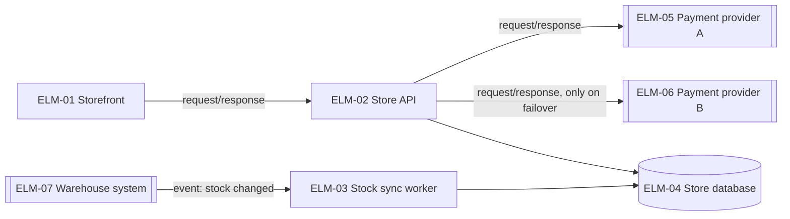
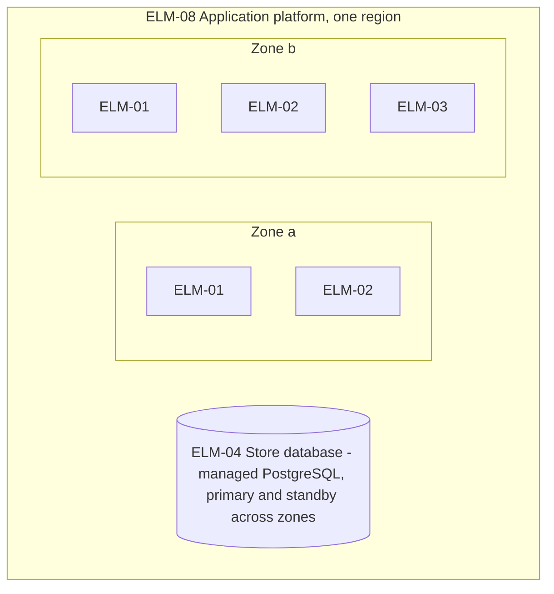

# Stage 2 report template and worked example

## Contents
- Report template (`docs/design/2-architecture.md`)
- Worked example: online store
- Example items

Write the report in the working language. Translate the headings. Keep the IDs as they are, and write the basis marks, statuses, kinds and ratings with the glossary's terms for the working language.

The report indexes the items and never restates what an item says. Refer to decisions and elements by ID and title, and leave their options, rationales, responsibilities, parameter values and other text to the YAML. Only the report holds the summary, the comparison tables of options, the design concerns, the threat model, the views, the walkthroughs, the cost check, the issues for the quality chain, the questions and their answers, the open assumptions, the placeholders, the open gaps and what is out of scope.

## Report template

```markdown
# Architecture: <system name>

Status: draft | answers applied · Updated: <date> · Inputs as of: <commit, or "none"> · Stage 2 of 4

## Summary
<Two or three sentences: the overall structure and the platforms, the decisions the primary drivers forced, the drivers at risk, and the open assumptions that matter most.>

## Inputs
| Source | What it gave |
|---|---|

## Overall structure
<The decisions that set the structure and the platforms, by ID, with the comparison table of their options, as in decisions.md. The views show the result.>

## Design decisions
| DEC | Title | Addresses | Deferred | Basis |
|---|---|---|---|---|
<Under the table, one comparison table for every other decision that addresses a primary driver, as in decisions.md.>

## Design concerns
| Concern | Settled by, or why standard practice is enough |
|---|---|

## Threat model
<The data flow diagram with trust boundaries, then the table of flows, threats and counters, as in views.md.>

## Elements
| ELM | Name | Kind | Team | As-is |
|---|---|---|---|---|

## Views
### Context
### Runtime
### Deployment
### Information
### Code structure
<One Mermaid diagram each, with a short table under it when needed.>

## Walkthroughs
### CUJs
<One table per CUJ, as in views.md.>
### Primary drivers
<One table, as in views.md.>

## Design parameters
| Parameter | Decision | Decided in |
|---|---|---|
<Decided in: the question under "Decisions" that settled it, or the DAS that adopted it provisionally.>

## Debt and deferred decisions
| DEC | Debt or deferral | Decided in |
|---|---|---|
<Decided in: the question under "Decisions", or the DAS of kind decision.>

## Cost and team
<The running cost from stated prices or placeholders, computed with a script; the work to build it; the skills it needs; the verdict.>

## Findings
| FND | Title | Raised by | Addressed to | Status |
|---|---|---|---|---|
<The findings addressed to this stage, and those this stage raised for stage 1.>

## Issues for the quality chain
| # | Issue | Chain items | Suggested change | Quality-chain stage |
|---|---|---|---|---|
<Include the answers to questions about the quality chain's assumptions (QAS), for the quality chain to apply on its next run.>

## Decisions
| # | Question | Answer | Items |
|---|---|---|---|
<Questions asked and answers in effect, numbered per stage and continued on re-runs; an overturning answer replaces the row.>

## Open assumptions
| ID | Title | Kind | Breadth | Severity | Items that depend on it |
|---|---|---|---|---|---|
<The DAS this stage wrote, and the open DAS and QAS its items depend on.>

## Placeholders
| Name | Stands for | Used in |
|---|---|---|

## Open gaps
## Out of scope
## Next
<Run `design-review` on this stage in a fresh context; re-run this stage to resolve its findings; then run `architecture-to-high-level-design`.>
```

## Worked example: online store

Header:

```markdown
Status: answers applied · Updated: 2026-11-03 · Inputs as of: 3f2a9c1 · Stage 2 of 4
```

Design decisions (excerpt):

| DEC | Title | Addresses | Deferred | Basis |
|---|---|---|---|---|
| DEC-01 | One application with enforced modules, a stock sync worker and a server-rendered storefront | DRV-09, DRV-01, DRV-03 | no | inferred |
| DEC-02 | Fail over to a second payment provider | DRV-02, DRV-10 | no | assumed |
| DEC-03 | Stock changes arrive as events; ELM-02 keeps a short stock cache | DRV-03 | no | assumed |
| DEC-06 | Fraud screening inside each provider's charge | DRV-01, DRV-06 | no | inferred |
| DEC-09 | The provider's hosted card fields | DRV-08 | no | inferred |
| DEC-10 | Browsers the storefront supports | DRV-11 | no | confirmed |

DEC-02 and DEC-03 are assumed because each depends on an open assumption (DAS-02, DAS-03). DEC-03 also lists DAS-01, which question 3 confirmed, and is not assumed on its account. DEC-10 is confirmed by question 1. DEC-01 was not a question: the stated team and deadline behind DRV-09 leave no doubt about it, so it stays inferred.

Elements (excerpt):

| ELM | Name | Kind | Team | As-is |
|---|---|---|---|---|
| ELM-01 | Storefront | component | TEAM-01 | new |
| ELM-02 | Store API | component | TEAM-01 | new |
| ELM-03 | Stock sync worker | component | TEAM-01 | new |
| ELM-04 | Store database | data store | TEAM-01 | new |
| ELM-05 | Payment provider A | external system | — | new |
| ELM-06 | Payment provider B | external system | — | new |
| ELM-07 | Warehouse system | external system | — | new |
| ELM-08 | Application platform | node | TEAM-01 | new |

ELM-05 and ELM-06 both play the role of EXT-01 in `context.yaml` and list it in `premises`; ELM-06 exists because of DEC-02. ELM-07 plays the role of EXT-02.

Runtime view:



ELM-01's pages load a checkout script in the buyer's browser, and that script calls ELM-02 directly, through the load balancer in front of ELM-02: the system boundary, which is SLI-02's vantage.

Deployment view:



Design concerns (excerpt):

| Concern | Settled by, or why standard practice is enough |
|---|---|
| Concurrency | DEC-05 (idempotency keys for payments); stock reservations use row locks, which is standard practice with the one database of DEC-01 |
| Distribution | DEC-01, DEC-04: two zones in one region; one region is enough this cycle (QR-16 excluded; DRV-12 keeps region settings in one place) |
| Variability | DEC-10 for the browsers (TC-03 fixes a web app); otherwise standard practice is enough: one market, one currency, no tenants |

Walkthrough of DRV-01 (excerpt):

| DRV | Where the stimulus enters | Decisions that shape the response | Meets the measure? | Remaining risk |
|---|---|---|---|---|
| DRV-01 | ELM-01's checkout script → ELM-02 | DEC-01, DEC-06, DEC-03 (cached stock) | Likely: the charge at the provider's stated 99.9th percentile (1.0 s) leaves 0.5 s for our own work and the database | During failover (DEC-02), checkouts are slower until the failing provider's breaker opens: stage 3 must check that against NFR-02's error budget, and must settle the first provider's outcome before charging the second (DRV-05) |

Design parameters (excerpt):

| Parameter | Decision | Decided in |
|---|---|---|
| failover_after | DEC-02 | question 2 |
| stock_cache_lifetime | DEC-03 | DAS-03 |

Debt and deferred decisions (excerpt):

| DEC | Debt or deferral | Decided in |
|---|---|---|
| DEC-02 | debt: failover ships right after the spring sale | stage 1, question 5 |

Decisions (excerpt):

| # | Question | Answer | Items |
|---|---|---|---|
| 1 | TC-03 keeps the storefront a web app. Which browsers must browsing and checkout work in? | The current and the previous major version of Safari and Chrome on phones, and of Chrome, Edge, Safari and Firefox on computers, as drafted. | DEC-10, ELM-01 |
| 2 | Checkout must keep confirming orders through a payment provider outage (DRV-02). Fail over to a second provider, at the cost of a second contract, or keep one provider with retries, which cannot ride out an outage? | Fail over to a second provider, as drafted, starting after 5 consecutive errors or 10 s of timeouts, and tune that threshold with the providers' error rates. The running cost of the second contract is accepted. | DEC-02, ELM-06 |
| 3 | Stage 1 assumed, without asking, that the warehouse system announces stock changes (DAS-01). The structure now rests on it: DEC-03, the stock sync worker (ELM-03) and the runtime view. Does the warehouse system send an event when a stock count changes? | Yes: it sends one event per stock change; the warehouse team confirmed it. | DAS-01, DEC-03, ELM-03 |

Question 3 asks about an assumption that stage 1 wrote: the structure rests on it (DEC-03, ELM-03 and the runtime view), so its breadth is high, and this stage asked it ("Assumptions" in `conventions.md`). DAS-01 records the answer in `answer`, with `answered_in` set to "stage 2, question 3", and its status is `confirmed`. DEC-03 and ELM-03 list DAS-01 in `premises` and cite the answer in `basis_note`; stage 1 applies it to DRV-03 when it runs again.

Open assumptions (excerpt):

| ID | Title | Kind | Breadth | Severity | Items that depend on it |
|---|---|---|---|---|---|
| DAS-02 | The second payment provider works like the first | judgment | medium | low | DEC-02, ELM-06 |
| DAS-03 | Stock cache lifetime | decision | low | low | DEC-03 |

Placeholders (excerpt):

| Name | Stands for | Used in |
|---|---|---|
| T_stock_lag | The time within which a stock change must be shown (QR-03) | DEC-03, DAS-03 |
| A_failover | The share of checkouts that must succeed during a provider outage (DRV-02) | Walkthroughs: DRV-02 |

## Example items

`docs/design/dec/DEC-02.yaml`:

```yaml
id: DEC-02
title: Fail over to a second payment provider
status: active
basis: assumed
basis_note: The second provider and its starting failover threshold confirmed in question 2; the debt, failover shipping right after the spring sale, decided in stage 1, question 5; the second provider working like the first assumed (DAS-02); the rest inferred
premises: [TC-01, CHG-01, DAS-02]
stage: architecture
question: How does checkout keep confirming orders when the payment provider fails?
addresses: [DRV-02, DRV-10]
options:
  - name: One provider, retries with back-off
    effect: Rides out short errors; an outage still stops checkout
    cost: Little work
  - name: Fail over to a second provider
    effect: Checkout continues while either provider is down
    cost: A second contract and integration; reconciliation across two providers
chosen: Fail over to a second provider
rationale: DRV-02 asks checkout to continue through a provider outage, which retries cannot do; CHG-01 already plans a second provider
rejected:
  - {option: "One provider, retries with back-off", reason: Does not meet DRV-02 during an outage}
gains: [Checkout survives an outage of either provider]
costs: [A second integration to build and test, Reconciliation must cover two providers]
sensitive_points: [The error threshold that opens a provider's breaker - too low switches back and forth; too high keeps buyers waiting on a failing provider]
trade_offs: [{with: DRV-07, note: A second contract raises running cost}]
assumptions: ["The second provider works like the first: hosted card fields, and fraud screening inside its charge (DAS-02)"]
depends_on: [DEC-01]
parameters:
  - {name: failover_after, value: 5 consecutive errors or 10 s of timeouts, basis: "Provisional starting value, answered with the second provider (stage 2, question 2); tune with the providers' error rates"}
debt:
  what: Failover ships right after the spring sale; until then an outage of the provider stops checkout
  why_accepted: "The business keeps the date and accepts the risk (stage 1, question 5)"
  repay_when: Right after the spring sale
deferred: false
revisit_when: null
as_is: new
```

`docs/design/das/DAS-03.yaml`, a provisional design parameter adopted without asking. Its statement names the parameter and leaves its value in DEC-03's `parameters`, so that tuning it changes one file:

```yaml
id: DAS-03
title: Stock cache lifetime
status: open
stage: 2
kind: decision
statement: ELM-02 caches stock counts for the provisional stock_cache_lifetime in DEC-03's parameters, a share of T_stock_lag that leaves the rest for a warehouse event to reach ELM-04
why_unsure: A provisional design parameter; how long the event path really takes is not known until it runs
breadth: low
severity: low
rating_note: Only DEC-03 depends on it; a setting of ELM-02 that is tuned in operation
answer: null
answered_in: null
```
