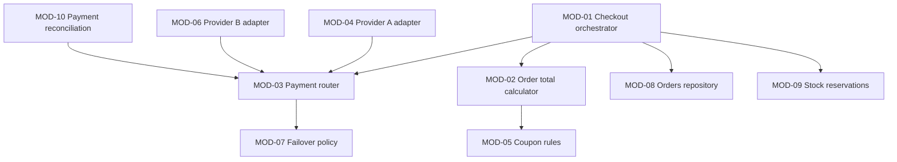
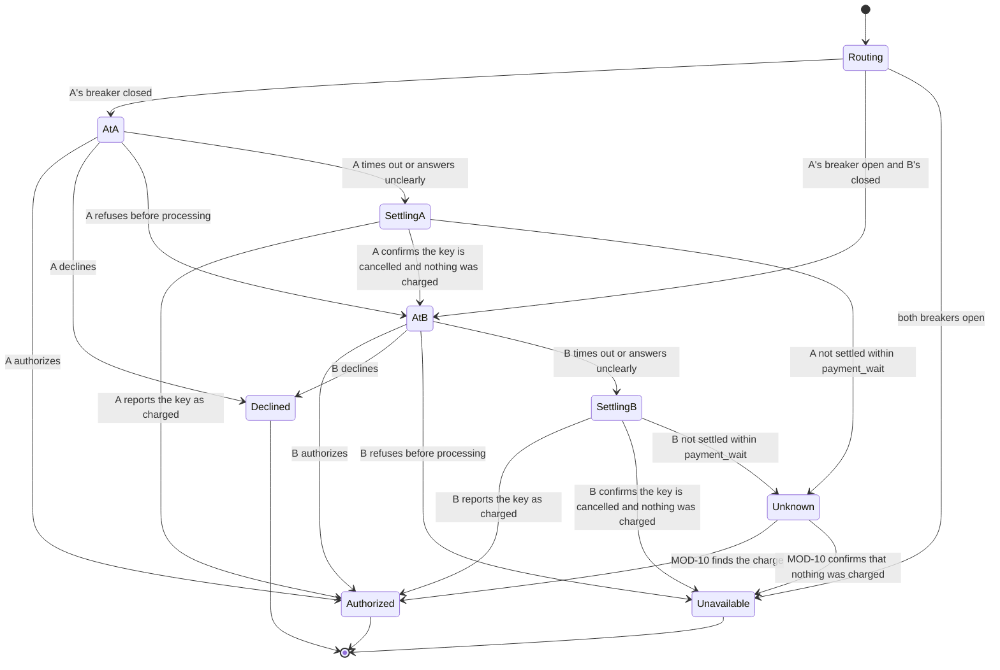

# Stage 4 report template and worked example

## Contents
- Component report template (`docs/design/4-detailed-design/<ELM-ID>.md`)
- The index
- Worked example: Store API (ELM-02)
- Example items

Write the report in the working language. Translate the headings. Keep the IDs, type names, operation names, table and column names as they are, and write the basis marks and statuses with the glossary's terms for the working language.

The report indexes the items and never restates them. A module's responsibility, contracts, invariants, checks and parameter values live in its MOD item; a decision's options and rationale live in its DEC item. The report holds what no item holds: diagrams, decision tables, algorithms, concurrency and error handling, the physical data model, caches, screens, the allocation of acceptance criteria, the verification approach across modules, and the decisions and gaps in effect.

`scripts/tables.py` writes the tables between `<!-- generated: <name> -->` and `<!-- /generated -->` from the items ("Scripts" in `conventions.md`): the modules, the design decisions, the design parameters, the findings, the open assumptions, and the whole index. Do not edit them by hand. In them, the report writes only these cells, which the script keeps: where each parameter was decided and how it fits the stage 3 budgets, and the breadth and severity of a quality-chain assumption as this component rates it (the script starts them from the QAS's own). Every other table is written by hand.

## Component report template

```markdown
# Detailed design of <component name>: <system name>

Status: draft | answers applied · Updated: <date> · Inputs as of: <commit, or "none"> · Stage 4 of 4 · Component: <ELM-ID>

## Summary
<Two or three sentences: the modules, the hardest behaviour, the questions asked, and the open assumptions with the highest ratings.>

## Inputs
| Source | What it gave |
|---|---|

## Modules
<The module dependency diagram in Mermaid and the dependency rule CI checks, then the index of the MOD items:>
<!-- generated: modules -->
| MOD | Name | Visibility | Functions | Realizes | As-is | Basis |
|---|---|---|---|---|---|---|
<!-- /generated -->

## Allocation
| FR, IFC or SLI | Criterion, operation or field | MOD |
|---|---|---|
<By hand: each acceptance criterion of the component's FRs, and each event and field its SLI bindings need, with the module it goes to. The operations each module realizes are in the module index.>

## Types
<The structured types the signatures use, each with its fields and their types.>

## Module details
<One section per module, with only what its MOD item cannot hold. Its heading is the one the item's `behaviour` field names.>
### <MOD-ID> <name>
#### Behaviour
<State diagram, decision tables, algorithm steps with their cost and edge cases, as they apply.>
#### Concurrency and errors
<What runs at the same time, what is locked and what must be atomic; which errors are handled here, which become the module's own errors, which are passed on.>

## Data
<The entity-relationship diagram of the data entities the component owns, then one section per table:>
### <table>
| Column | Type | Null | Constraint | Note |
|---|---|---|---|---|
| Index | Columns | For query |
|---|---|---|
### Transactions
<What each transaction writes, and which module runs it.>
### Readers from other components
<Tables another component reads directly: who, with which rights, under which decision.>
### Migrations
<Existing schemas only.>

## Caches
| Cache | MOD | Holds | Key | Lifetime parameter | Invalidated by | On a miss |
|---|---|---|---|---|---|---|
<Then each in-memory structure, with its size bound.>

## Screens
<Only when the component serves people.>

## Verification approach
<What serves several modules: test doubles for external systems, environments, load tests, checks in CI. Each module's own checks are in its MOD item.>

## Design parameters
<!-- generated: parameters -->
| Parameter | MOD | Decision | Budget or timeout it fits |
|---|---|---|---|
<!-- /generated -->
<One row per entry of the modules' `parameters`: values inside the component only. The timeouts and waits on calls to other elements are in the IFCs' `timing`, and the modules refer to them by IFC ID. By hand: Decision, the DAS that adopts the value provisionally or the question that decided it; the last column, how the worst case follows from the stage 3 budgets and timeouts.>

## Design decisions
<!-- generated: decisions -->
| DEC | Title | Addresses | Basis |
|---|---|---|---|
<!-- /generated -->
<The DEC items this stage wrote for the component, frameworks included: the decisions of stage `detailed-design` that its modules list in `decisions`.>

## Findings
<!-- generated: findings -->
| FND | Title | Severity | Raised by | To | Status | Items changed |
|---|---|---|---|---|---|---|
<!-- /generated -->
<The findings addressed to this stage for this component (they target the component, its modules or its decisions, or were raised in its reports), and the findings this stage raised in this report. Items changed are the items whose `basis_note` cites the finding.>

## Issues for the quality chain
| # | Issue | Chain items | Suggested change | Quality-chain stage |
|---|---|---|---|---|

## Decisions
| # | Question | Answer | Items |
|---|---|---|---|
<The questions asked and the answers in effect, numbered per component report and continued when the component is re-run. An answer that overturns an earlier one replaces its row.>

## Open assumptions
<!-- generated: assumptions -->
| ID | Title | Kind | Breadth | Severity | Items that depend on it |
|---|---|---|---|---|---|
<!-- /generated -->
<The open DAS this stage wrote that this component's modules and decisions depend on, and the open DAS and QAS in the `premises` of those modules and decisions, of the interfaces the component provides or consumes, and of the data entities it owns, highest ratings first. Breadth and severity of a QAS, by hand: as this component rates it.>

## Placeholders
| Name | Stands for | Used in |
|---|---|---|

## Open gaps
## Out of scope
## Next
<Run `design-review` on this component in a fresh context; re-run the stages that this report's findings are addressed to; re-run this stage for the component to resolve the findings the review addresses to it; then design the next component in the index.>
```

## The index

Keep `docs/design/4-detailed-design.md` as `artifacts.md` shows: one row per component element, with its status, report and modules, in a table that `scripts/tables.py` writes. Update its header at the end of every run, with the date and the run's `Inputs as of` commit.

## Worked example: Store API (ELM-02)

Header:

```markdown
Status: answers applied · Updated: 2026-11-12 · Inputs as of: 8d41b07 · Stage 4 of 4 · Component: ELM-02
```

Modules:



The provider adapters depend on the payment router's provider interface, never the other way round, so a third provider adds one module (DRV-10). CI rule: nothing outside MOD-04 and MOD-06 imports a provider's client library.

Module index (excerpt):

| MOD | Name | Visibility | Functions | Realizes | As-is | Basis |
|---|---|---|---|---|---|---|
| MOD-01 | Checkout orchestrator | public | FR-01 | IFC-01 POST /v1/checkout | new | inferred |
| MOD-02 | Order total calculator | internal | FR-03 | — | new | inferred |
| MOD-03 | Payment router | internal | FR-01 | — | new | inferred |
| MOD-10 | Payment reconciliation | internal | FR-01 | — | new | assumed |

MOD-10 is assumed because its reconciliation interval is a provisional decision (DAS-09). MOD-03 is not: the timing it uses is IFC-02's, and rests on stage 3's DAS-06 through IFC-02.

Payment attempt in MOD-03. A timeout leaves the outcome unknown, so the router settles it with the same provider (look up the order's key, and cancel it if it went through) before it tries another one. Otherwise a late success at A plus a charge at B would charge the buyer twice (DRV-05, FND-01):



`Unavailable` means that every provider tried confirmed that nothing was charged; only then does IFC-01 answer PAYMENT_UNAVAILABLE. While an attempt is `Unknown`, IFC-01 answers PAYMENT_PENDING and the order waits as PaymentUnknown.

Table `payment_attempts` (excerpt). One row per attempt at one provider; a second provider gets a new row. Rows are never deleted, and an attempt's state only moves forward along MOD-03's diagram.

| Column | Type | Null | Constraint | Note |
|---|---|---|---|---|
| attempt_id | uuid | no | primary key | |
| order_id | uuid | no | foreign key to orders | |
| idempotency_key | text | no | unique together with provider | The order's key from IFC-01, sent to each provider tried |
| provider | text | no | check in (A, B) | |
| provider_charge_id | text | yes | unique together with provider | The provider's own ID for the charge, stored when the provider returns one (question 1) |
| state | text | no | check in the states of MOD-03 | |
| amount_minor | bigint | no | check > 0 | Money in minor units (shared conventions) |
| created_at | timestamptz | no | | |

| Index | Columns | For query |
|---|---|---|
| attempts_key | provider, idempotency_key (unique) | Find the attempt a provider already holds for a repeated checkout |
| attempts_charge | provider, provider_charge_id (unique) | MOD-10 finds the attempt for each line of a provider's settlement report |
| attempts_unknown | state, created_at, where state is Unknown | MOD-10's list of attempts to settle |
| attempts_order | order_id | Every attempt of one order, for reconciliation and support |

Design parameters (excerpt):

| Parameter | MOD | Decision | Budget or timeout it fits |
|---|---|---|---|
| reconcile_every | MOD-10 | DAS-09 | Outside every request: MOD-10 runs on its own schedule, and no caller waits for it |

MOD-03 sets no timing of its own. It waits for provider A within IFC-02's provider_timeout and settles an unknown outcome within IFC-02's payment_wait; stage 3 owns both values (DAS-06) and has checked their worst case against IFC-01's timeout. A change to them would be a finding addressed to `architecture-to-high-level-design`.

Decisions (excerpt). Both were asked because their severity is high: question 1 fixes the shape of stored data, and question 2 decides how much buyers pay.

| # | Question | Answer | Items |
|---|---|---|---|
| 1 | MOD-10 matches each provider's settlement report with our payment attempts. Do the reports carry our idempotency key, or only the provider's own charge ID? | Only the provider's own charge ID, for both providers. Keep the charge ID on each attempt, unique per provider, and match the reports by it. | MOD-03, MOD-10 |
| 2 | How is a percentage coupon rounded: once on the order, or line by line? | Once on the order. The percentage applies to the sum of the eligible lines, and the discount is rounded down to the minor unit, so that a buyer never gets more than the stated percentage. | MOD-02, MOD-05 |

Issues for the quality chain (excerpt):

| # | Issue | Chain items | Suggested change | Quality-chain stage |
|---|---|---|---|---|
| 1 | FR-03's acceptance criteria do not say how a percentage discount is rounded; question 2 decided it for the design | FR-03 | Add the rounding rule of question 2 as an acceptance criterion | 2 |

Open assumptions (excerpt):

| ID | Title | Kind | Breadth | Severity | Items that depend on it |
|---|---|---|---|---|---|
| DAS-02 | The second payment provider works like the first | judgment | medium | low | DEC-02, ELM-06, MOD-06 |
| DAS-06 | Timeouts on the payment path adopted provisionally | decision | medium | low | IFC-01, IFC-02 |
| DAS-09 | Reconciliation interval in MOD-10 adopted provisionally | decision | low | low | MOD-10 |

DAS-06 is stage 3's. No module lists it, but MOD-03 uses IFC-02's timing, which rests on it, so a change to it reaches MOD-03 through IFC-02.

## Example items

`docs/design/mod/MOD-03.yaml`:

```yaml
id: MOD-03
title: Payment router
status: active
basis: inferred
basis_note: Follows DEC-02, DEC-05 and FND-01; waits and settles within the provider_timeout and payment_wait of IFC-02's timing, which stage 3 owns; keeping each provider's charge ID is confirmed (question 1); the rest is inferred
premises: []
component: ELM-02
name: Payment router
responsibility: Turns each order's payment into one settled outcome, trying one provider at a time
visibility: internal
interface:
  - operation: "pay(request: PaymentRequest) -> PaymentOutcome"
    pre: The order is pending and its total is fixed
    post: At most one provider holds a charge for the order; the outcome says which, or that it is not settled yet
    errors: ["PaymentUnavailable: every provider tried confirmed that nothing was charged", "PaymentUnknown: an outcome could not be settled within payment_wait (IFC-02's timing); the order waits as PaymentUnknown"]
invariants: ["A provider is tried only after every provider tried before it has settled with no charge"]
depends_on: [MOD-07]
functions: [FR-01]
realizes: []                             # internal; MOD-04 and MOD-06 realize the providers' interfaces
drivers: [DRV-02, DRV-05, DRV-10]
decisions: [DEC-02, DEC-05]
behaviour: "Report section: MOD-03 Payment router"
verification:
  - {checks: Every row of the failover policy table (MOD-07), how: Unit tests with fake providers}
  - {checks: No double charge when A times out and completes its charge later, how: An integration test with a provider stub that answers after its timeout}
parameters: []                           # its waits are IFC-02's timing, set in stage 3; it sets none of its own
as_is: new
```

`docs/design/das/DAS-09.yaml`, a provisional design parameter adopted without asking. Its statement names the parameter and leaves its value in MOD-10, so that tuning it changes one file, and its rating note says what lies outside the component, so that no dependent is hidden:

```yaml
id: DAS-09
title: Reconciliation interval in MOD-10 adopted provisionally
status: open
stage: 4
kind: decision
statement: MOD-10 looks for payment attempts in Unknown every reconcile_every, a provisional value, until operation shows how soon the providers can report the outcome of a charge that timed out
why_unsure: A provisional design parameter; how soon a provider can report such an outcome is not known until it runs
breadth: low
severity: low
rating_note: Only MOD-10 depends on it, and no item outside ELM-02 does - IFC-01 promises no time within which a pending payment settles, and the timeouts and waits on calls to the providers are in IFC-02's timing (DAS-06); tuned in operation
answer: null
answered_in: null
```
