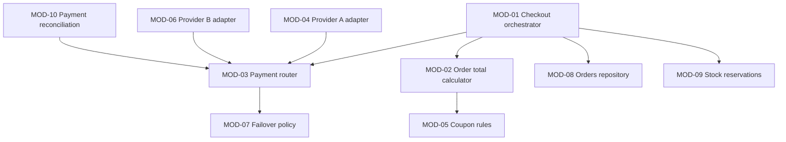
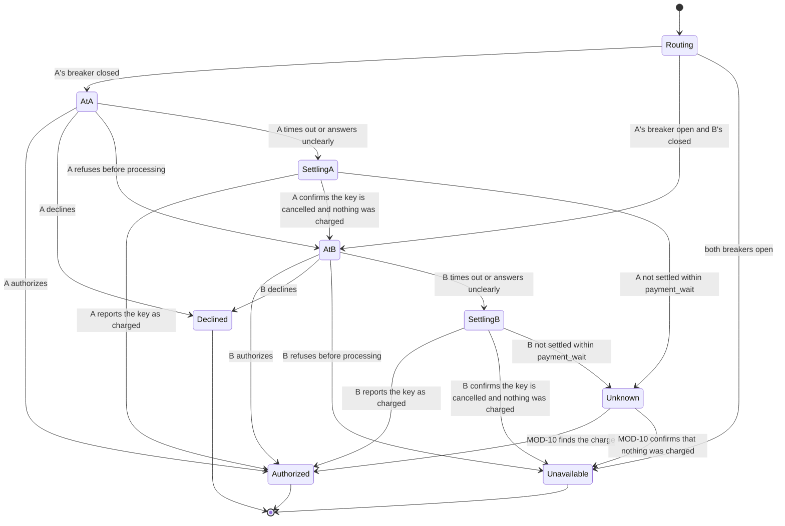

# Stage 4 report template and worked example

## Contents
- Component report template (`docs/design/4-detailed-design/<ELM-ID>.md`)
- The index
- Worked example: Store API (ELM-02)
- Example items

Write the report in the working language. Translate the headings. Keep the IDs, type names, operation names, table and column names as they are, and write the basis marks and statuses with the glossary's terms for the working language.

The report indexes the items and never restates them. A module's depth, responsibility, contracts, invariants, checks and parameter values live in its MOD item; a decision's options and rationale live in its DEC item. The report holds what no item holds: for the modules at full depth, their diagrams, decision tables, algorithms, concurrency and error handling, the physical data that keeps their invariants, caches and screens; for the component, the verification approach across modules, and the decisions, assumptions and gaps in effect. A module at bounds depth has no section: its MOD item is all the design says about it.

## Component report template

```markdown
# Detailed design of <component name>: <system name>

Status: draft | answers applied · Updated: <date> · Inputs as of: <commit, or "none"> · Stage 4 of 4 · Component: <ELM-ID>

## Summary
<Two or three sentences: the modules and which are at full depth, the hardest behaviour, the questions asked, and the open assumptions with the highest ratings.>

## Inputs
| Source | What it gave |
|---|---|

## Modules
<The module dependency diagram in Mermaid and the dependency rule CI checks, then an index of the MOD items; for an existing component, add an As-is column:>
| MOD | Name | Depth | Visibility | Functions | Realizes | Basis |
|---|---|---|---|---|---|---|

## Allocation
| FR, IFC or SLI | Criterion, operation or field | MOD |
|---|---|---|

## Types
<The structured types the signatures use, each with its fields and their types.>

## Module details
<One section per module at full depth, with only what its MOD item cannot hold. Its heading is the one the item's `behaviour` field names. A module at bounds depth has none.>
### <MOD-ID> <name>
#### Behaviour
<State diagram, decision tables, algorithm steps with their cost and edge cases, as they apply.>
#### Concurrency and errors
<What runs at the same time, what is locked and what must be atomic; which errors are handled here, which become the module's own errors, which are passed on.>

## Data
<The physical data that keeps the invariants the modules at full depth rely on, one section per table that holds such an invariant. Implementation designs the rest of the tables within the DATs.>
### <table> (<DAT-ID>)
| Invariant | Kept by | MOD |
|---|---|---|
### Transactions
<The transactions that keep an invariant: what each writes, and which module runs it.>
### Readers from other components
<Each table another component reads directly, designed in full: who reads it, with which rights, under which decision, and its columns.>
| Column | Type | Null | Constraint | Note |
|---|---|---|---|---|
### Migrations
<Existing schemas only.>

## Caches
<The caches of the modules at full depth.>
| Cache | MOD | Holds | Key | Lifetime parameter | Invalidated by | On a miss |
|---|---|---|---|---|---|---|
<Then each in-memory structure of those modules, with its size bound.>

## Screens
<Only for screens that a module at full depth serves: the validation of each input, with its messages, and what the accessibility requirements need. The screen's states are in the module's state diagram.>

## Verification approach
<What serves several modules: test doubles for external systems, environments, load tests, checks in CI. Each module's own checks are in its MOD item.>

## Design parameters
| Parameter | MOD | Decision | Budget or timeout it fits |
|---|---|---|---|
<Only values inside the modules at full depth; implementation sets those of the modules at bounds depth. The timeouts and waits that stage 3 set on calls to other elements are in the IFCs' `timing`, and the modules refer to them by IFC ID. Decision: the DAS that adopts the value provisionally, or the question that decided it. The last column shows how the worst case follows from the stage 3 budgets and timeouts.>

## Design decisions
| DEC | Title | Addresses | Basis |
|---|---|---|---|
<The DEC items this stage wrote for the component, frameworks included.>

## Findings
| FND | Title | Raised by | To | Status |
|---|---|---|---|---|
<The findings addressed to this stage for this component, and the findings this stage raised.>

## Issues for the quality chain
| # | Issue | Chain items | Suggested change | Quality-chain stage |
|---|---|---|---|---|

## Decisions
| # | Question | Answer | Items |
|---|---|---|---|
<The questions asked and the answers in effect, numbered per component report and continued when the component is re-run. An answer that overturns an earlier one replaces its row.>

## Open assumptions
| ID | Title | Kind | Breadth | Severity | Items that depend on it |
|---|---|---|---|---|---|
<The DAS this run wrote, and the open DAS and QAS that this component's items depend on, highest ratings first.>

## Placeholders
| Name | Stands for | Used in |
|---|---|---|

## Open gaps
## Out of scope
## Next
<Run `design-review` on this component in a fresh context; re-run the stages that this report's findings are addressed to; re-run this stage for the component to resolve the findings the review addresses to it; then design the next component in the index.>
```

## The index

Keep `docs/design/4-detailed-design.md` as `artifacts.md` shows: one row per component element, with its status, its report and its modules at each depth, then the hand-off to implementation. The hand-off starts with the three rules for implementation, written as `artifacts.md` gives them, since coding agents read them before anything else, and lists every open hand-off addressed to implementation, whichever stage wrote it. Update the index at the end of every run, with the date and the run's `Inputs as of` commit in its header.

## Worked example: Store API (ELM-02)

Header:

```markdown
Status: answers applied · Updated: 2026-11-12 · Inputs as of: 8d41b07 · Stage 4 of 4 · Component: ELM-02
```

Modules:



The provider adapters depend on the payment router's provider interface, never the other way round, so a third provider adds one module (DRV-10). CI rule: nothing outside MOD-04 and MOD-06 imports a provider's client library.

Module index (excerpt):

| MOD | Name | Depth | Visibility | Functions | Realizes | Basis |
|---|---|---|---|---|---|---|
| MOD-01 | Checkout orchestrator | full | public | FR-01 | IFC-01 POST /v1/checkout | inferred |
| MOD-02 | Order total calculator | full | internal | FR-03 | | inferred |
| MOD-03 | Payment router | full | internal | FR-01 | | inferred |
| MOD-08 | Orders repository | bounds | internal | FR-01 | | inferred |
| MOD-10 | Payment reconciliation | full | internal | FR-01 | | assumed |

MOD-10 is assumed because its reconciliation interval is a provisional decision (DAS-09). MOD-03 is not: the timing it uses is IFC-02's, and rests on stage 3's DAS-06 through IFC-02.

Every module on the checkout path but one is at full depth: each moves money, settles an unknown outcome, shares state with checkouts that run at the same time, or applies a rule with several conditions. MOD-08 is at bounds depth: two checkouts with the same key race in MOD-01, which settles the race, and the unique key that keeps one order per key is under "Data"; MOD-08 only stores and reads what MOD-01 hands it. The catalog and the order history (MOD-11 and MOD-12) are at bounds depth too. None of the three has a section in this report.

Payment attempt in MOD-03. A timeout leaves the outcome unknown, so the router settles it with the same provider (look up the order's key, and cancel it if it went through) before it tries another one. Otherwise a late success at A plus a charge at B would charge the buyer twice (DRV-05, FND-01):



`Unavailable` means that every provider tried confirmed that nothing was charged; only then does IFC-01 answer PAYMENT_UNAVAILABLE. While an attempt is `Unknown`, IFC-01 answers PAYMENT_PENDING and the order waits as PaymentUnknown.

Table `payment_attempts` (DAT-03). One row per attempt at one provider; a second provider gets a new row. The invariants that MOD-03 and MOD-10 rely on, and what keeps each:

| Invariant | Kept by | MOD |
|---|---|---|
| A provider holds at most one attempt for an order's key | unique (provider, idempotency_key); the key is the order's key from IFC-01, sent to each provider tried | MOD-03 |
| A line of a provider's settlement report matches at most one attempt | unique (provider, provider_charge_id) where provider_charge_id is set: the provider's own ID for the charge (question 1) | MOD-10 |
| An attempt's state only moves forward along MOD-03's diagram | check: state in the states of MOD-03; every update names the state it moves from, and changes nothing when the row has moved on | MOD-03, MOD-10 |
| An attempt is never deleted, and only its state and provider_charge_id change | the service's database role has no right to delete rows of the table, nor to update its other columns | MOD-03, MOD-10 |
| The amount is positive, in minor units (shared conventions) | check amount_minor > 0 | MOD-03 |

The other columns and their types, and the indexes that queries need (MOD-10's list of attempts in Unknown, the attempts of one order for support), are implementation's, within DAT-03. Table `orders` (DAT-01) holds one invariant here, MOD-01's: one order per Idempotency-Key, kept by a unique key on the order's key. The rest of it is implementation's, within DAT-01.

Design parameters (excerpt):

| Parameter | MOD | Decision | Budget or timeout it fits |
|---|---|---|---|
| reconcile_every | MOD-10 | DAS-09 | Outside every request: MOD-10 runs on its own schedule, and no caller waits for it |

MOD-03 sets no timing of its own. It waits for provider A within IFC-02's provider_timeout and settles an unknown outcome within IFC-02's payment_wait; stage 3 owns both values (DAS-06) and has checked their worst case against IFC-01's timeout. A change to them would be a finding addressed to `architecture-to-high-level-design`.

Decisions (excerpt). Both were asked because their severity is high: question 1 fixes the shape of stored data, and question 2 decides how much buyers pay.

| # | Question | Answer | Items |
|---|---|---|---|
| 1 | MOD-10 matches each provider's settlement report with our payment attempts. Do the reports carry our idempotency key, or only the provider's own charge ID? | Only the provider's own charge ID, for both providers. Keep the charge ID on each attempt, unique per provider, and match the reports by it. | MOD-03, MOD-10 |
| 2 | How is a percentage coupon rounded: once on the order, or line by line? | Once on the order. The percentage applies to the sum of the eligible lines, and the discount is rounded down to the minor unit, so that a buyer never gets more than the stated percentage. | MOD-02, MOD-05 |

Issues for the quality chain (excerpt):

| # | Issue | Chain items | Suggested change | Quality-chain stage |
|---|---|---|---|---|
| 1 | FR-03's acceptance criteria do not say how a percentage discount is rounded; question 2 decided it for the design | FR-03 | Add the rounding rule of question 2 as an acceptance criterion | 2 |

Open assumptions (excerpt):

| ID | Title | Kind | Breadth | Severity | Items that depend on it |
|---|---|---|---|---|---|
| DAS-02 | The second payment provider works like the first | judgment | medium | low | DEC-02, ELM-06, MOD-06 |
| DAS-06 | Timeouts on the payment path adopted provisionally | decision | medium | low | IFC-01, IFC-02 |
| DAS-09 | Reconciliation interval in MOD-10 adopted provisionally | decision | low | low | MOD-10 |

DAS-06 is stage 3's. No module lists it, but MOD-03 uses IFC-02's timing, which rests on it, so a change to it reaches MOD-03 through IFC-02.

## Example items

`docs/design/mod/MOD-03.yaml`:

```yaml
id: MOD-03
title: Payment router
status: active
basis: inferred
basis_note: Follows DEC-02, DEC-05 and FND-01; waits and settles within the provider_timeout and payment_wait of IFC-02's timing, which stage 3 owns; keeping each provider's charge ID is confirmed (question 1); the rest is inferred
premises: []
component: ELM-02
name: Payment router
depth: full
depth_reason: Moves money and settles unknown outcomes
responsibility: Turns each order's payment into one settled outcome, trying one provider at a time
visibility: internal
interface:
  - operation: "pay(request: PaymentRequest) -> PaymentOutcome"
    pre: The order is pending and its total is fixed
    post: At most one provider holds a charge for the order; the outcome says which, or that it is not settled yet
    errors: ["PaymentUnavailable: every provider tried confirmed that nothing was charged", "PaymentUnknown: an outcome could not be settled within payment_wait (IFC-02's timing); the order waits as PaymentUnknown"]
invariants: ["A provider is tried only after every provider tried before it has settled with no charge"]
depends_on: [MOD-07]
functions: [FR-01]
realizes: []                             # internal; MOD-04 and MOD-06 realize the providers' interfaces
drivers: [DRV-02, DRV-05, DRV-10]
decisions: [DEC-02, DEC-05]
behaviour: "Report section: MOD-03 Payment router"
verification:
  - {checks: Every row of the failover policy table (MOD-07), how: Unit tests with fake providers}
  - {checks: No double charge when A times out and completes its charge later, how: An integration test with a provider stub that answers after its timeout}
parameters: []                           # its waits are IFC-02's timing, set in stage 3; it sets none of its own
as_is: new
```

`docs/design/mod/MOD-08.yaml`, a module at bounds depth. Its contract is a summary of what MOD-01 relies on, and it has no section in the report. How it stores orders is implementation's, within DAT-01 and the unique key under "Data":

```yaml
id: MOD-08
title: Orders repository
status: active
basis: inferred
basis_note: null
premises: []
component: ELM-02
name: Orders repository
depth: bounds
depth_reason: null
responsibility: Stores each order with its lines, and reads an order back by its key
visibility: internal
interface:                               # the summary its callers rely on
  - operation: "createPending(draft: OrderDraft, key: IdempotencyKey) -> Order"
    pre: null
    post: The order and its lines are stored as pending, together (DAT-01)
    errors: ["KeyTaken: an order with this key exists; MOD-01 reads it with findByKey"]
  - operation: "findByKey(key: IdempotencyKey) -> Order or none"
    pre: null
    post: The order stored with this key, if there is one
    errors: []
invariants: []
depends_on: []
functions: [FR-01]
realizes: []
drivers: [DRV-05]
decisions: []
behaviour: null                          # no report section: implementation designs its inside
verification:
  - {checks: One order per key when two calls with the same key run at the same time, how: An integration test against the database}
  - {checks: The order and its lines are stored together or not at all, how: An integration test that makes the write of a line fail}
parameters: []
as_is: new
```

`docs/design/das/DAS-09.yaml`, a provisional design parameter adopted without asking. Its statement names the parameter and leaves its value in MOD-10, so that tuning it changes one file, and its rating note says what lies outside the component, so that no dependent is hidden:

```yaml
id: DAS-09
title: Reconciliation interval in MOD-10 adopted provisionally
status: open
stage: 4
kind: decision
statement: MOD-10 looks for payment attempts in Unknown every reconcile_every, a provisional value, until operation shows how soon the providers can report the outcome of a charge that timed out
why_unsure: A provisional design parameter; how soon a provider can report such an outcome is not known until it runs
breadth: low
severity: low
rating_note: Only MOD-10 depends on it, and no item outside ELM-02 does - IFC-01 promises no time within which a pending payment settles, and the timeouts and waits on calls to the providers are in IFC-02's timing (DAS-06); tuned in operation
answer: null
answered_in: null
```
